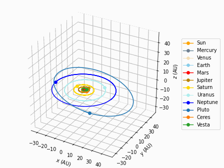
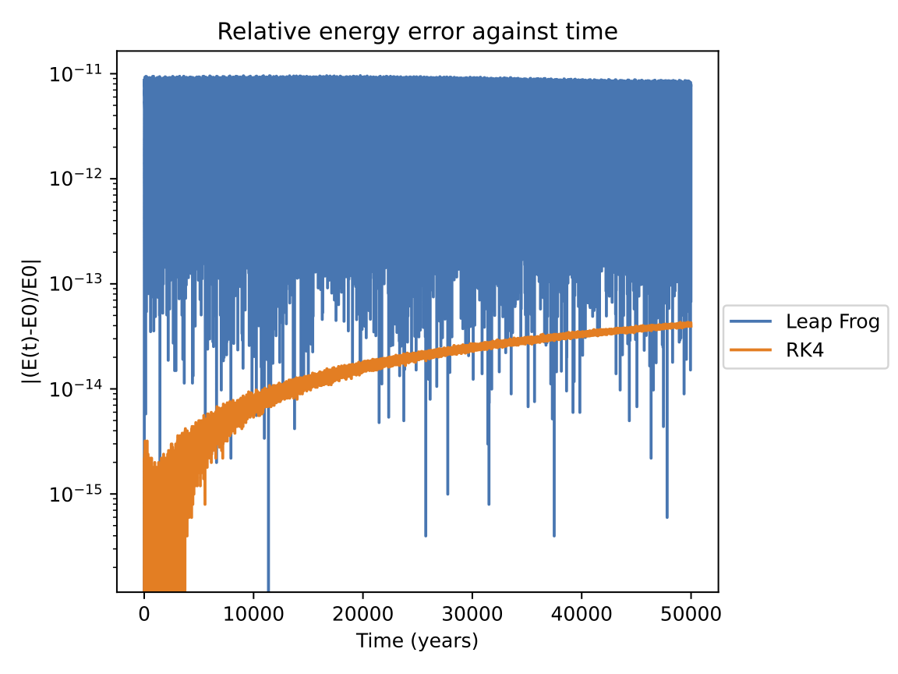
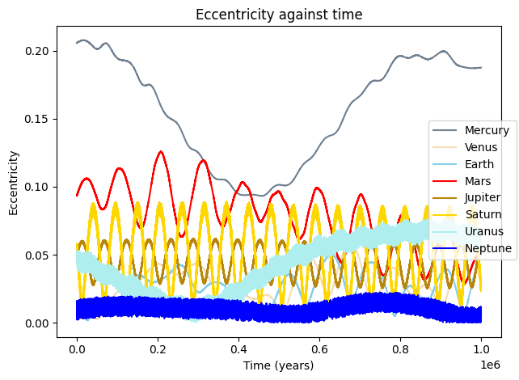
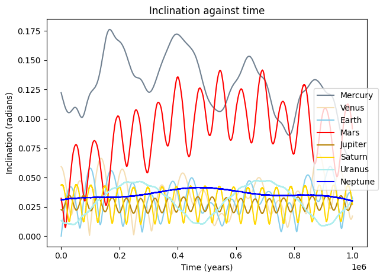

# grav_sim

N-body gravity simulation library with C and Python API

- Source code: <https://github.com/alvinng4/grav_sim>
- Project Homepage and documentations: <https://alvinng4.com/grav_sim/>

**Target Audience:**

* Physics students
* Anyone interested in N-body simulations

**Features:**

* Ten integrators including WHFast and IAS15
* Barnes-Hut algorithm with linear octree
* Particle-Mesh method for cosmological structure formation
* Multiple sample projects

## 5 steps to N-body simulation

A short course to teach beginners how to write fast and clean N-body gravity simulations code in Python.

Homepage: https://alvinng4.com/grav_sim/5_steps_to_n_body_simulation/

**Contents**

- [Step 1: Initial setup](5_steps_to_n_body_simulation/step1.md)
- [Step 2: Gravity](5_steps_to_n_body_simulation/step2.md)
- [Step 3: Your first N-body program](5_steps_to_n_body_simulation/step3.md)
- [Step 4: Higher-order algorithms](5_steps_to_n_body_simulation/step4.md)
- [Step 5: Adaptive time-stepping](5_steps_to_n_body_simulation/step5.md)
- [Extra: Plotting and animation](5_steps_to_n_body_simulation/extra.md)
- [Conclusion and Final Project](5_steps_to_n_body_simulation/conclusion.md)

## Sample projects

### Evolving the solar system for 1 million years

### Asteroid belt animation

  
  

### Formation of Kirkwood gaps

  

### Galaxy collision

### Cosmological structure formation

## Feedback and Bugs
If you found any bugs or want to leave some feedback, please feel free to let me know by opening an issue or sending an email to alvinng324(at)gmail.com.
